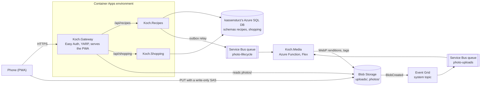
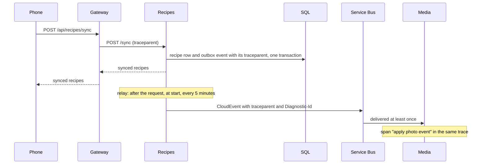

# Kochbuch

*Rezepte mit Fotos, Zutaten und Schritten – und eine Einkaufsliste, die Mengen aus mehreren Rezepten zusammenrechnet.*

A recipe PWA for a two-person household:
- Both phones share the same recipes, synced like [kassensturz](https://github.com/temvarin/kassensturz).
- Pick recipe 1 and recipe 2 and get one shopping list: 500 g + 300 g Kartoffeln = 800 g.

The fourth app in the series after 33-von-33, fallstrick and kassensturz. This one is built **as microservices on Azure on purpose, as a learning goal**. [ADR-0001](docs/adr/0001-microservices-as-a-learning-goal.md) explains why, where the books disagree, and when to merge services back.

> **Status: all seven phases built; not yet deployed to Azure.**
>
> Working:
> - recipes with photos, ingredients and steps, scaled to any number of servings, offline, synced between both phones
> - shopping lists from chosen recipes with matching ingredients added up (500 g + 300 g = 800 g), by aisle, ticked off on
>   both phones
> - photos: uploaded straight from the phone to Blob Storage, turned into WebP renditions by an Azure Function (camera
>   metadata and GPS position removed), served by the gateway and kept offline by the service worker
> - photo clean-up: Recipes publishes "attached"/"detached" through a transactional outbox, and Media deletes photos no
>   recipe has shown for 30 days
> - monitoring: OpenTelemetry into Application Insights with one trace from the phone's sync to Media, saved KQL
>   queries, three alerts by mail, and gateway releases checked at a `next` label before they get traffic
>
> - two phones editing one recipe keep both edits: a three-way merge per part (title, each ingredient line, steps, …)
> - browser tests of the whole household: two phones, offline edits, a shared shopping list, accessibility checks

## Architecture

Every app sends traces, metrics and logs to Application Insights with OpenTelemetry ([ADR-0009](docs/adr/0009-observability-alerts-and-staged-releases.md)).
One trace follows a recipe saved with a photo across the asynchronous hop:



| Decision | ADR |
|---|---|
| Microservices as a learning goal; few, justified boundaries | [0001](docs/adr/0001-microservices-as-a-learning-goal.md) |
| One gateway signs in; services trust the user it names | [0002](docs/adr/0002-gateway-sign-in-and-trust.md) |
| kassensturz's database, one schema and one identity per service | [0003](docs/adr/0003-shared-database-schema-per-service.md) |
| Recipe sync: kassensturz's protocol, one row per recipe, ingredient ids from their names | [0004](docs/adr/0004-recipe-sync.md) |
| Shopping lists built on the phone, one item per contribution, a shared kernel | [0005](docs/adr/0005-shopping-lists.md) |
| Photos: valet-key upload, Event Grid → Service Bus → Function, served by the gateway | [0006](docs/adr/0006-photo-pipeline.md) |
| Service Bus Basic queues, no topics; Event Grid for storage events | [0007](docs/adr/0007-service-bus-basic.md) |
| Photo clean-up: transactional outbox, events ordered by sequence, blob tags, daily sweep | [0008](docs/adr/0008-outbox-and-photo-lifecycle.md) |
| Observability: OpenTelemetry into Application Insights, one trace across the outbox, three alerts, staged gateway releases | [0009](docs/adr/0009-observability-alerts-and-staged-releases.md) |
| Concurrent recipe edits merged part by part with the phone's base; browser tests of the household; no topic yet | [0012](docs/adr/0012-recipe-merge-and-browser-tests.md) |

### Projects
| Project | What |
|---|---|
| `src/Koch.App` | Blazor WebAssembly PWA, German UI, hand-written CSS |
| `src/Koch.Gateway` | The only public app: Easy Auth handler, Member policy, YARP proxy, security headers, hosts the PWA |
| `src/Koch.Recipes` | Recipes service: `POST /sync`; `Storage/` is the only code that talks to SQL; `Outbox/` relays photo events to Service Bus |
| `src/Koch.Shopping` | Shopping service: `POST /sync` for lists and their items |
| `src/Koch.Shopping.Domain` | Pure list rules shared by the app and the service: combining amounts, lines, ticking, sync |
| `src/Koch.Media` | Azure Function (Flex Consumption): turns uploads into renditions, applies photo events as blob tags, sweeps detached photos daily |
| `src/Koch.Media.Imaging` | Pure photo work: validate, turn upright, WebP at 400 and 1200 px, nothing of the original kept |
| `src/Koch.Kernel` | Shared vocabulary and sync abstractions: units, quantities, aisles, `Synced<TBook, TChanges>` |
| `src/Koch.Recipes.Domain` | Pure rules shared by the app and the service: recipes, quantities, catalogue, sync (ported from kassensturz), local store |
| `src/Koch.*.Contracts`, `src/Koch.Recipes.Events` | One small library per producer and purpose: what others compile against, nothing else |
| `src/Koch.ServiceDefaults` | Hosting plumbing every service shares: the forwarded user, the synced rows in SQL with their outbox |
| `src/Koch.Telemetry` | How the HTTP apps report: OpenTelemetry into Application Insights, every trace kept, health probes left out |
| `tools/Koch.DbDeploy` | Applies `db/<service>/*.sql` in CI with Entra auth |
| `tools/Koch.DevPhotos` | Development only: prepares Azurite and processes uploads the way Event Grid + Media do in Azure (no photo events: locally they stay in `recipes.Outbox`) |
| `tests/*` | Domain (rules, randomized multi-phone sync, contract samples), Recipes (store contract on SQL and memory, sync API, row samples), App (bUnit pages against the real service in memory, lost answers, offline), Gateway (auth, proxy, spoofed headers), Media (renditions, photo events, traces), Architecture (boundaries, KQL checked against the tables) |
| `tests/Koch.E2E` | Playwright: the real gateway and app on a real port, the services in memory, Anna's and Ben's phones as two browser contexts; axe accessibility checks |
| `infra/` | Bicep: observability with saved queries, identities, Container Apps environment, apps (the gateway in staged revisions), Easy Auth config, photos, messaging, alerts, budget alarm |
| `infra/queries` | KQL: one trace end to end, failures, latency percentiles, photo events, outbox relay, ingestion against the cap |

## Development
Needs the .NET 10 SDK (`global.json`) and SQL Server LocalDB (kassensturz's dev database `Kassensturz`).

1. Put the schema into the local database once:
   ```powershell
   $env:KOCH_DB_CONNECTION = 'Server=(localdb)\MSSQLLocalDB;Database=Kassensturz;Integrated Security=true'
   dotnet run --project tools/Koch.DbDeploy -- db/recipes db/shopping
   ```
2. Run the services and the gateway and open http://localhost:8091. In Development the gateway signs you in as `dev`.
   ```powershell
   dotnet run --project src/Koch.Recipes      # http://localhost:8092
   dotnet run --project src/Koch.Shopping     # http://localhost:8093
   dotnet run --project src/Koch.Gateway      # http://localhost:8091
   ```
   Photos locally need the storage emulator and the stand-in for Event Grid + Media (Node.js for Azurite):
   ```powershell
   npx -y azurite@3 --location .azurite --skipApiVersionCheck
   ```
   ```powershell
   dotnet run --project tools/Koch.DevPhotos
   ```
3. Tests (SQL tests use LocalDB, or `KOCH_TEST_SQL`; the browser tests use the installed Edge):
   ```powershell
   dotnet test -c Release
   ```
4. Infrastructure:
   ```powershell
   bicep build infra/main.bicep; bicep lint infra/main.bicep
   ```

## Deployment
CI deploys every push to `main`. The one-time Azure, Entra, SQL and GitHub setup is in [docs/deployment.md](docs/deployment.md).

Cost target: **under $1 a month** on top of kassensturz:
- scale-to-zero Container Apps and a Flex Consumption Function inside their free grants
- Service Bus Basic, Event Grid's free operations, a few cents of Blob Storage
- public GHCR images instead of ACR
- a log cap
- no extra database

A $3 budget alarm watches it; the three alerts add about $0.40.

## License
PolyForm Noncommercial 1.0.0, like the sibling apps (add `LICENSE.md` before publishing).
