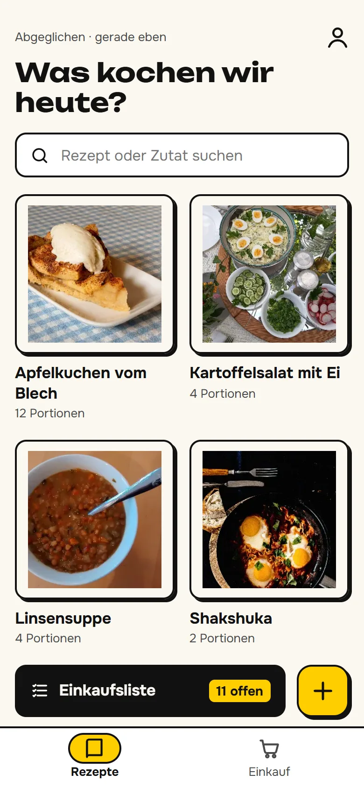
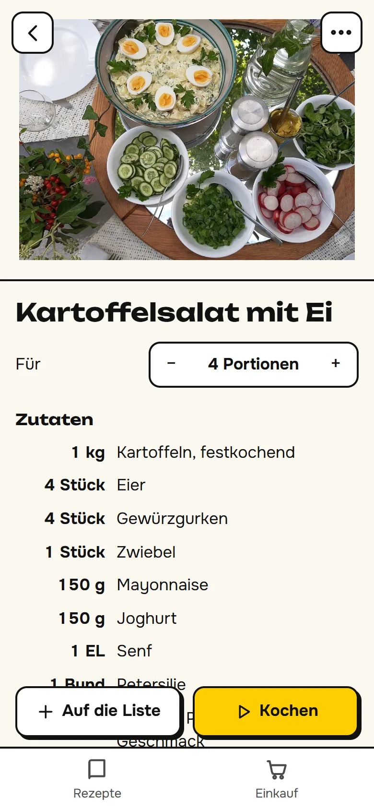
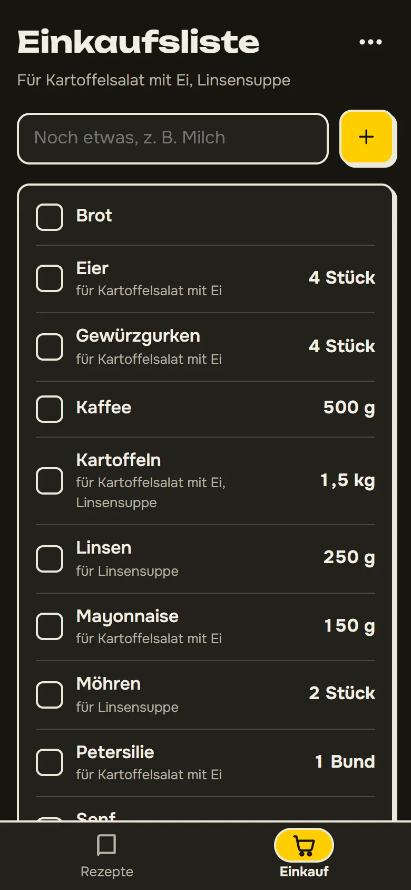
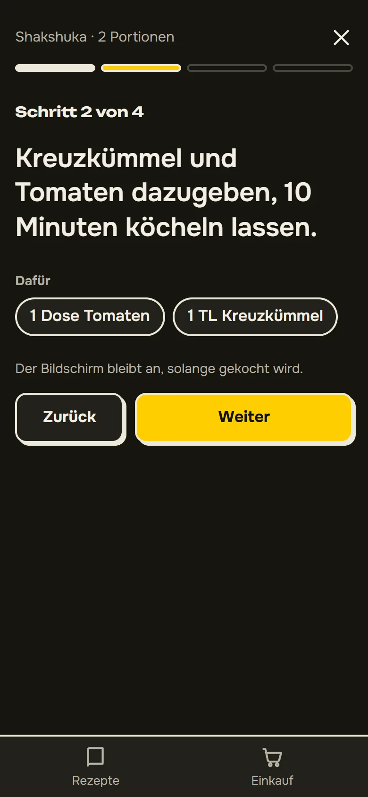

# Kochbuch

*Our recipes on both phones – and one shopping list that does the sums.*

[](https://github.com/temvarin/kochbuch/actions/workflows/ci.yml)
[](LICENSE.md)

A recipe app for a household of two:
- **Recipes** with a photo, ingredients and steps, shared between both phones and editable offline.
- **One shopping list** for the week: put two recipes on it and matching ingredients add up – 1 kg + 500 g Kartoffeln = 1,5 kg.

It is an offline-capable web app (PWA) built with Blazor WebAssembly, like its siblings [33 von 33](https://github.com/temvarin/33-von-33), [Fallstrick](https://github.com/temvarin/fallstrick) and [Kassensturz](https://github.com/temvarin/kassensturz). Unlike them, it runs on Azure as three small microservices – on purpose, as a learning project.

**[Open the app →](https://kochbuch-gateway.kindforest-fea25c89.swedencentral.azurecontainerapps.io)** – signing in is limited to the household's two Microsoft accounts. Add it to your home screen to use it like an installed app ([how](#install-on-a-phone)).

| Recipes | Recipe | Shopping list | Cooking |
|:---:|:---:|:---:|:---:|
|  |  |  |  |

## Why

Our recipes lived in screenshots, browser bookmarks and a paper folder, and the shopping list was written by hand. Kochbuch keeps the recipes in one place that both of us edit, also in a kitchen without signal, and turns the week's plan into one list that both phones tick off.

The second reason is learning microservice deployment on Azure for almost nothing (~$0.02–$0.05/month on an Azure for Students account): three focused deployables, each with a real architectural boundary:
1. **Koch.Gateway** (Container App, external): edge/BFF, Entra Easy Auth, serves the PWA and photos, proxies `/api/*`.
2. **Koch.Api** (Container App, internal): synchronous transactional backend owning Recipes and Shopping in separate SQL schemas.
3. **Koch.Media** (Azure Functions, Flex Consumption): asynchronous event-driven image processor (`Blob Storage → Event Grid → Service Bus → Function`) that strips EXIF/GPS and writes WebP renditions.

## Features

- **Recipes:** a photo, ingredients and steps, scaled to any number of servings. Units are stored as codes (`g`, `EL`, `Glas`), and each phone chooses German or Russian for the whole UI and units (*2 EL* or *2 ст. л.*). Search by recipe or ingredient.
- **One shopping list:** recipes go onto it from their page at the servings chosen. Matching ingredients add up within a kind of unit (1 kg + 500 g = 1,5 kg), and both phones tick off the same list in the shop.
- **Cooking view:** one step per screen in large type, with the ingredients that step needs, and the screen kept on.
- **Photos:** uploaded straight to Blob Storage via a short-lived valet-key SAS URL, converted into small EXIF-free WebP renditions, and cached offline by the service worker.
- **Sync between both phones:** changes made offline go out with the next sync. Concurrent edits to the same recipe merge three ways, part by part.
- **Works offline**, installs to the home screen on iPhone and Android, and follows dark mode. No tracking.

## Install on a phone

- **iPhone:** open the app in **Safari** → Share → *Add to Home Screen*.
- **Android:** open the app in **Chrome** → ⋮ menu → *Add to Home screen* → *Install*.

## Architecture

One .NET 10 solution with 6 `src/` projects, 1 dev tool, and 4 test projects:

```
src/
  Koch.App/         Blazor WebAssembly PWA: Recipes/, Shopping/, Sync/, Account/, Shell/
  Koch.Gateway/     Public Container App: Easy Auth, YARP proxy, security headers, photo SAS & serving
  Koch.Api/         Internal Container App: Recipes & Shopping sync endpoints + Azure SQL row store
  Koch.Media/       Azure Function (Flex Consumption): Event Grid -> Service Bus -> WebP renditions
  Koch.Domain/      Shared pure rules: Kernel/, Measures/, Recipes/, Shopping/ (no UI, no I/O)
  Koch.Contracts/   Shared wire DTOs & PhotoPaths (zero dependencies)
tools/
  Koch.DevPhotos/   Local dev only: watches Azurite uploads/ and runs PhotoProcessor
tests/
  Koch.Domain.Tests/    Domain rules, 3-way merge, randomized multi-phone sync, shopping amounts
  Koch.Services.Tests/  Gateway auth/proxy/photos, API sync endpoints, SQL & memory document store
  Koch.Media.Tests/     EXIF/GPS stripping, orientation, bomb/size limits, PhotoProcessor, BlobCreated
  Koch.App.Tests/       bUnit page tests against in-memory Koch.Api
infra/
  main.bicep        Single-file Azure IaC (Container Apps, Easy Auth, Storage, Event Grid, Service Bus, Functions, Budget)
db/
  schema.sql        Idempotent SQL tables (recipes.Documents, shopping.Documents with temporal history)
  manual/grants.sql Least-privilege managed identity grants (run once by hand)
```

- **Zero secrets:** Easy Auth uses a federated managed identity; SQL, Blob Storage, and Service Bus use managed identities; GitHub Actions deploys via OIDC and pulls public GHCR images.
- **Shared database, isolated schemas:** `Koch.Api` uses Kassensturz's Azure SQL Basic database via `recipes` and `shopping` schemas.
- **Strict build:** .NET 10, `AnalysisLevel=latest-recommended`, warnings as errors, source-generated JSON.

## Development

Requires the .NET 10 SDK (`global.json`), SQL Server LocalDB, and Node.js for Azurite (photos).

1. Apply `db/schema.sql` once to your local `Kassensturz` database (e.g. via `sqlcmd` or SSMS/Azure Data Studio).
2. Run the API and the gateway, then open `http://localhost:8091` (in Development the gateway signs requests in as `dev`):
   ```powershell
   dotnet run --project src/Koch.Api          # http://localhost:8092
   dotnet run --project src/Koch.Gateway      # http://localhost:8091
   ```
3. For photos, start Azurite and the local photo processor:
   ```powershell
   npx -y azurite@3 --location .azurite --skipApiVersionCheck
   dotnet run --project tools/Koch.DevPhotos
   ```
4. Tests (SQL tests use LocalDB or `KOCH_TEST_SQL`):
   ```powershell
   dotnet test -c Release
   ```
5. Infrastructure check:
   ```powershell
   az bicep build --file infra/main.bicep --stdout > $null; az bicep lint --file infra/main.bicep
   ```

## Deployment

Every push to `main` runs `.github/workflows/ci.yml`:
1. **Test:** builds and runs all 4 test projects (with a SQL Server 2022 container) and lints `infra/main.bicep`.
2. **Deploy:**
   - Builds and pushes `kochbuch-gateway` and `kochbuch-api` container images to GHCR (`dotnet publish -t:PublishContainer`).
   - Deploys `infra/main.bicep` (Container Apps `Single` revision mode with `/healthz` Startup probes).
   - Publishes and deploys `Koch.Media` to Azure Functions Flex Consumption.
   - Smoke-checks `/healthz`, `/`, and `401` gates on `/api/whoami`, `/api/recipes/status`, and `/api/shopping/sync`.

**Cost (~$0.02–$0.05/month excl. Kassensturz SQL):** Container Apps and Flex Consumption Functions scale to zero inside free grants; Service Bus Basic (`photo-uploads`), Event Grid, Blob Storage (LRS), and Log Analytics (0.1 GB/day cap) cost pennies; a `$3` Azure Budget alarm guards against surprises.

## Sources

- Fonts: [Onest](https://github.com/googlefonts/onest) and [Unbounded](https://github.com/googlefonts/unbounded) (SIL Open Font License, see `src/Koch.App/wwwroot/fonts/`).
- Photos in the screenshots, from Wikimedia Commons, all CC0: [potato salad](https://commons.wikimedia.org/wiki/File:Potato_salad,_Ehrenbach.jpg) by Gerda Arendt, [apple cake](https://commons.wikimedia.org/wiki/File:Apple_cake_with_vanilla_ice_cream_2.jpg) by W.carter, [lentil soup](https://commons.wikimedia.org/wiki/File:Amy%27s_lentil_vegetable_soup.jpg) by Mx. Granger, [shakshuka](https://commons.wikimedia.org/wiki/File:Shakshuka_(Unsplash).jpg) by Jarosław Ceborski.

See [THIRD-PARTY-NOTICES.md](THIRD-PARTY-NOTICES.md).

## License

Source-available under the [PolyForm Noncommercial License 1.0.0](LICENSE.md): you may read, run and adapt it for noncommercial purposes, but not sell it or use it commercially. The fonts and the photos in the screenshots keep their own terms; see [THIRD-PARTY-NOTICES.md](THIRD-PARTY-NOTICES.md).
